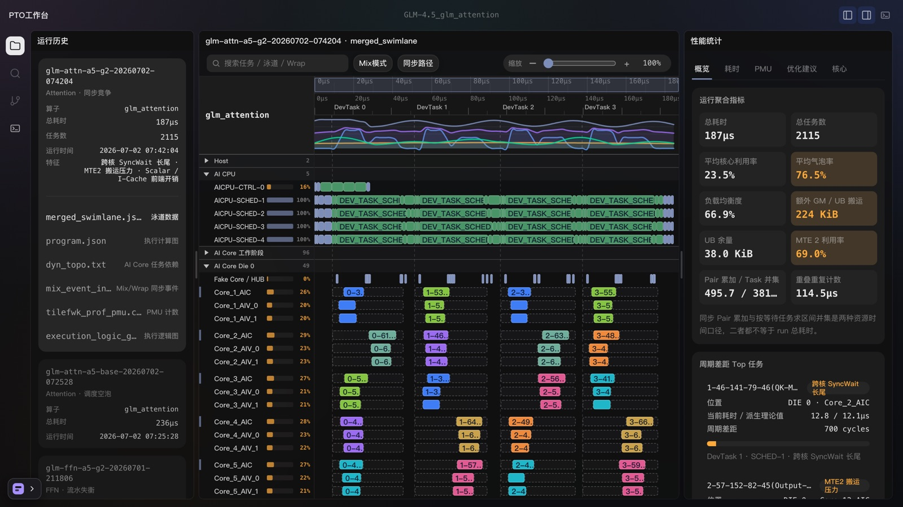
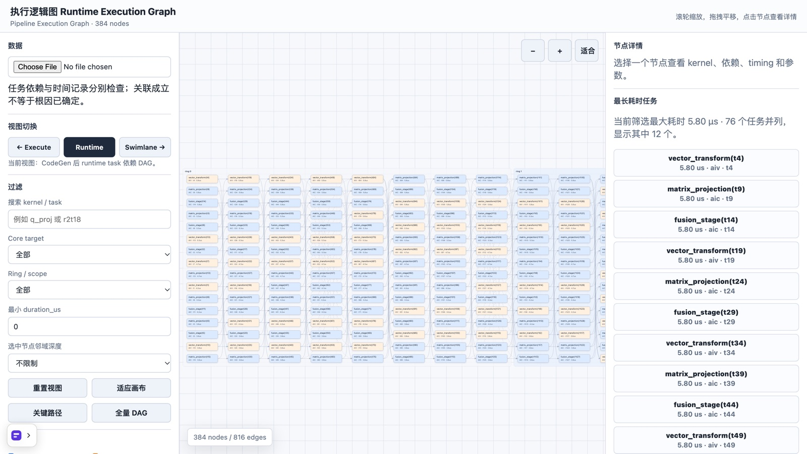
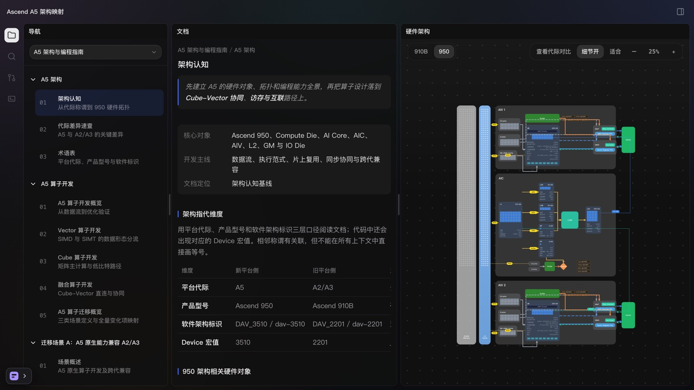

# PTO Design Lab

围绕算子开发与性能调优，汇集业务研究、体验设计方案和交互原型。

[浏览全部内容](https://wangnaiyu.github.io/pto-design-lab/)

## 交互 Demo

点击封面体验，无需安装环境或连接 NPU。

| [Swimlane Profiler](https://wangnaiyu.github.io/pto-design-lab/design/swimlane-profiler/) | [Runtime Explorer](https://wangnaiyu.github.io/pto-design-lab/design/runtime-execution-graph-explorer/) | [Ascend A5 架构映射](https://wangnaiyu.github.io/pto-design-lab/design/ascend-hardware-architecture/) |
| --- | --- | --- |
|  |  |  |
| 检查任务、同步等待与 PMU，预览调优建议。 | 筛选和定位任务，联动依赖图与对象详情。 | 关联硬件文档、架构对象与数据路径。 |

## 研究与设计

### 性能诊断

| 内容 | 重点 |
| --- | --- |
| [性能诊断竞品分析](https://wangnaiyu.github.io/pto-design-lab/research/performance-diagnosis-benchmark/) | 性能工具如何组织时间、资源与诊断信息。 |
| [性能调优体验设计](https://wangnaiyu.github.io/pto-design-lab/design/fusion-performance-experience/) | 用户画像、调优旅程与协作场景。 |
| [融合算子性能诊断方案](https://wangnaiyu.github.io/pto-design-lab/design/fusion-performance-diagnosis/) | 从异常任务到候选修改与验证的产品流程。 |
| [A5 PMU 数据可视化](https://wangnaiyu.github.io/pto-design-lab/design/a5-pmu-visualization/) | 采集组、计量口径与信息缺失的呈现。 |

### Agent 协作

| 内容 | 重点 |
| --- | --- |
| [Agent 时代的算子开发体验](https://wangnaiyu.github.io/pto-design-lab/research/agentic-operator-development/) | 可验收任务的委托、检查与接管。 |
| [Agent in the loop](https://wangnaiyu.github.io/pto-design-lab/design/agent-in-the-loop/) | 以任务、证据和受控实验组织人机协作。 |
| [IDE 内嵌 Skills](https://wangnaiyu.github.io/pto-design-lab/design/ide-embedded-skills/) | 20 页方案：将视图选区交给 Agent，让解释返回对应对象。 |
| [Ascend Agent Skills 研究](https://wangnaiyu.github.io/pto-design-lab/research/ascend-agent-skills/) | 固定历史快照中的聚合分发、源仓与版本关系。 |

### 执行逻辑

[执行逻辑图设计](https://wangnaiyu.github.io/pto-design-lab/design/runtime-execution-graph/)：任务身份、结构边、详情与降级规则。

## 内容说明与反馈

由 [wangnaiyu](https://github.com/wangnaiyu) 基于公开资料，使用 AI 辅助产出。各条目的 `sources.md` 记录来源、数据说明与版本依据。Demo 中的预计收益、未采集状态和硬件假设不代表实测结论。

反馈内容或交互问题，请在 [Issues](https://github.com/wangnaiyu/pto-design-lab/issues) 附上页面地址和复现步骤。

## 致谢

感谢 [yinyucheng0601](https://github.com/yinyucheng0601) 创作的 [PTO 设计系统](https://github.com/yinyucheng0601/pto-design-system)。Swimlane Profiler 与 Ascend A5 架构映射基于其规范、组件和 patterns 进行了适配。

## 使用范围

仅供浏览展示，不授予通用再利用许可，详见 [LICENSE](LICENSE)。第三方内容保留原有署名和条款。
